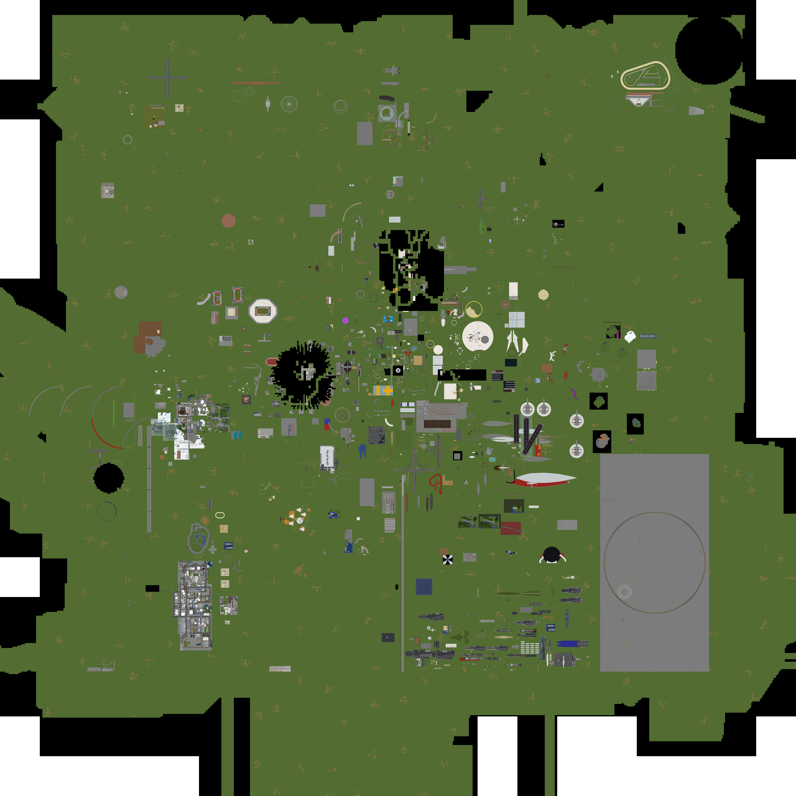

# TOROMapArchive

<https://map.torosaba.net/>

## main

## flat

## 仕組み

公開サイトは GitHub Pages の Actions 配信で動いており、gh-pages ブランチは使わない。

- 毎日のワークフロー (push.yaml) が地図画像を取得して main へコミットする。
- pages ジョブが 2048px 版の画像を作り (ImageMagick)、`GEN-SITE.CBL` (COBOL) が
  画像の一覧から `index.html` と `README.md` を生成する。
- 生成物は actions/upload-pages-artifact と actions/deploy-pages で配信される。

画像のリサイズだけは COBOL では扱えないため ImageMagick に残し、それ以外の
サイト生成は COBOL で行う。
