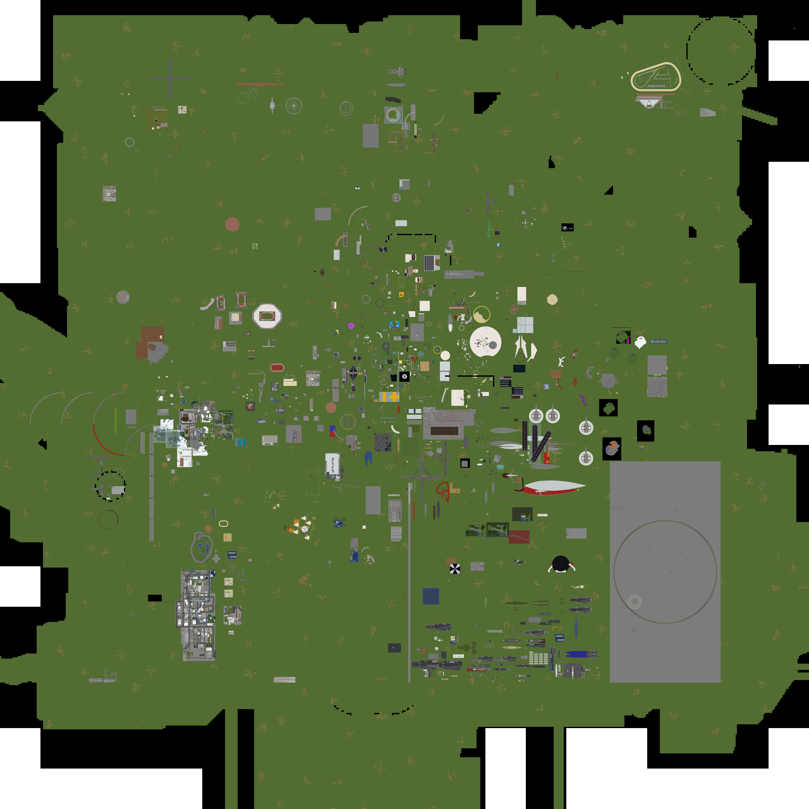

# TOROMapArchive

<https://map.torosaba.net/>

## main

## flat

## 仕組み

公開サイトは GitHub Pages (GitHub の無料のサイト公開機能) で動いています。公開の処理は GitHub Actions (GitHub が決まった時刻や操作で自動で処理を動かす仕組み) が直接行います。

処理の手順は [`.github/workflows/archive.yaml`](.github/workflows/archive.yaml) に書かれています。毎日 日本時間の午前 4 時に自動で動き、手動でも動かせます。

- 1 段階目: 地図画像を取得し、main ブランチへ保存します。日付のタグ (印) を付けます。
- 2 段階目: 同じ日付で、画像を添えた配布ページ (リリース) を作ります。
- 3 段階目: 2048px の縮小画像を作り (画像変換ソフト ImageMagick)、`GEN-SITE.CBL` (COBOL という昔からあるプログラミング言語) が画像の一覧から公開サイトの `index.html` を作って公開します。

画像のリサイズだけは COBOL では扱えないため ImageMagick に残し、それ以外の
サイト生成は COBOL で行います。
